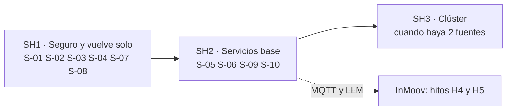
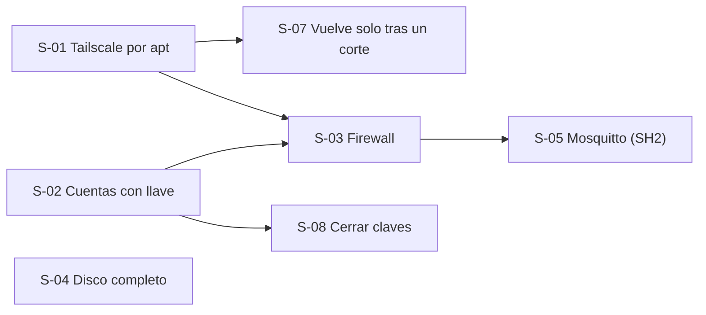

# Hoja de ruta del servidor

En qué orden se avanza y qué depende de qué. No hay fechas: un hito termina cuando se cumplen sus [requisitos](requisitos.md), no cuando pasa una semana. Cada hito es un *milestone* de GitHub, así que en el [tablero](https://github.com/orgs/railab-usach/projects/1) se ve cuánto le falta.

## SH1 · Servidor seguro y que vuelve solo
**Para qué:** que el servidor no dependa de claves compartidas, no se vea desde internet y sobreviva a un corte de luz. Todo lo demás se construye encima.
**Termina cuando:** se cumplen [RS-01](requisitos.md#rs-01-cada-persona-entra-con-su-propia-llave) a [RS-05](requisitos.md#rs-05-vuelve-solo-después-de-un-corte-de-luz) y [RS-09](requisitos.md#rs-09-sin-secretos-compartidos).
**Decisiones:** [ADR-0001](decisiones/0001-sistema-operativo.md), [ADR-0002](decisiones/0002-red-tailscale.md) y [ADR-0003](decisiones/0003-acceso-ssh.md), todavía en «propuesta». Las tareas de SH1 son de bajo arrepentimiento: sirven aunque esos ADR cambien en sus detalles.

| Tarea | Qué deja | Cumple | Depende de | ★ |
|---|---|---|---|---|
| S-01 | Tailscale instalado con `apt`, con el mismo nombre e IP, y llaves sin vencimiento | RS-02 | — | ★ |
| S-02 | Un usuario con llave para cada persona | RS-01 | — | ★ |
| S-03 | Firewall cerrado a internet, `fail2ban` y sin paquetes de NVIDIA | RS-03 | S-01, S-02 | ★ |
| S-04 | El disco de 500 GB completo para la raíz | RS-04 | — | ★ |
| S-07 | BIOS que enciende sola y una prueba de corte de luz | RS-05 | S-01 | ★★ |
| S-08 | SSH sin claves y `railab` sin inicio de sesión | RS-01, RS-09 | S-02 hecha por 2 personas | ★ |

## SH2 · Servicios base para los proyectos
**Para qué:** dejar los servicios que usan el InMoov y los demás proyectos (mensajería y modelo de lenguaje), instalados de forma que se puedan rearmar.
**Termina cuando:** se cumplen [RS-06](requisitos.md#rs-06-mensajería-mqtt-para-los-proyectos), [RS-07](requisitos.md#rs-07-modelo-de-lenguaje-por-la-api-estándar) y [RS-08](requisitos.md#rs-08-se-puede-rearmar-desde-cero).
**Decisiones:** [ADR-0004](decisiones/0004-servidor-llm.md) y el [ADR-0003 de inmoov-cabeza](https://github.com/railab-usach/inmoov-cabeza/blob/main/docs/decisiones/0003-mensajeria.md).

| Tarea | Qué deja | Cumple | Depende de | ★ |
|---|---|---|---|---|
| S-05 | Mosquitto como servicio y su configuración en el repo | RS-06 | S-03 | ★★ |
| S-06 | Guía «Conectarte a la red del lab» | RS-08 | S-01 | ★ |
| S-09 | Etiquetas `tag:servidor` y `tag:robot` y una ACL mínima en Tailscale | RS-02, RS-09 | S-01 | ★★★ · por pautar |
| S-10 | Medición de 8 modelos de lenguaje (reto E0-4) y el elegido por la API estándar | RS-07 | S-04 | ★★ · por pautar: falta `herramientas/bench_llm.py` |

## SH3 · Clúster (más adelante)
Con dos fuentes para los otros Z420 (unos $100.000 en total) se mide k3s contra Swarm y se decide en un ADR nuevo ([ADR-0005](decisiones/0005-orquestacion-cluster.md)). Hasta entonces no hay tareas.

## Cómo se toma una tarea
1. En el tablero, elige una tarea de «Por hacer» cuyas dependencias ya estén en «Listo». Una tarea en curso por persona.
2. Asígnatela y muévela a «En curso».
3. Lee los requisitos que cumple: sus criterios son tu definición de «listo».
4. Sigue los pasos. Si algo no calza, comenta en el issue antes de improvisar.
5. Deja la evidencia en el issue (captura o salida del comando, **sin IPs ni claves**) y muévela a «En revisión». Si cambiaste archivos del repo, abre un PR.
6. Quien coordina revisa y la pasa a «Listo».

Relacionado: [requisitos](requisitos.md) · [cómo trabajamos](metodologia.md) · Up: [documentación](README.md)
