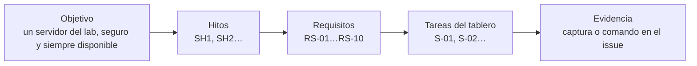

# Requisitos del servidor

Esta página dice **qué tiene que cumplir el servidor** para que los proyectos del lab lo puedan usar. Cada tarea del [tablero](https://github.com/orgs/railab-usach/projects/1) nombra los requisitos que cumple, así que antes de empezar una tarea sabes para qué sirve y cómo se comprueba que quedó lista. El orden en que se avanza está en la [hoja de ruta](hoja-de-ruta.md).

**Palabras que se usan aquí**
- **Requisito:** algo que el servidor debe hacer o cumplir, dicho de forma que se pueda comprobar.
- **Criterio de aceptación:** la prueba concreta (un comando o una medición) que dice si el requisito se cumple. «Funciona» o «se ve bien» no sirven como criterio.
- **Hito:** un grupo de requisitos que, cumplidos juntos, dejan algo útil terminado.
- **Bajo arrepentimiento:** una tarea que sirve sea cual sea la decisión final de los ADR abiertos.

## Resumen
| ID | Requisito | Hito | Tareas | Estado |
|---|---|---|---|---|
| [RS-01](#rs-01-cada-persona-entra-con-su-propia-llave) | Cada persona entra con su propia llave | SH1 | S-02, S-08 | pendiente |
| [RS-02](#rs-02-la-red-privada-no-se-corta-sola) | La red privada no se corta sola | SH1 | S-01 | pendiente |
| [RS-03](#rs-03-desde-internet-no-se-entra) | Desde internet no se entra | SH1 | S-03 | pendiente |
| [RS-04](#rs-04-espacio-para-modelos) | Espacio para modelos | SH1 | S-04 | pendiente |
| [RS-05](#rs-05-vuelve-solo-después-de-un-corte-de-luz) | Vuelve solo después de un corte de luz | SH1 | S-07 | pendiente |
| [RS-06](#rs-06-mensajería-mqtt-para-los-proyectos) | Mensajería MQTT para los proyectos | SH2 | S-05 | pendiente |
| [RS-07](#rs-07-modelo-de-lenguaje-por-la-api-estándar) | Modelo de lenguaje por la API estándar | SH2 | S-10 | pendiente |
| [RS-08](#rs-08-se-puede-rearmar-desde-cero) | Se puede rearmar desde cero | SH2 | todas | pendiente |
| [RS-09](#rs-09-sin-secretos-compartidos) | Sin secretos compartidos | SH1 | S-02, S-08, Camilo | pendiente |
| [RS-10](#rs-10-gratis-y-libre) | Gratis y libre | siempre | todas | se cumple |

## Requisitos

### RS-01 Cada persona entra con su propia llave
- **Qué:** cada administrador entra por SSH con su usuario y su llave `ed25519`. La cuenta compartida `railab` queda solo para correr servicios.
- **Se cumple cuando:**
  1. `ssh <tu-usuario>@hp-node-01` entra sin pedir clave.
  2. `ssh -o PubkeyAuthentication=no <tu-usuario>@hp-node-01` es rechazado.
  3. `getent passwd railab` termina en `/usr/sbin/nologin`.
- **Viene de:** [ADR-0003](decisiones/0003-acceso-ssh.md). **Tareas:** S-02 (cuentas) y S-08 (cerrar las claves).

### RS-02 La red privada no se corta sola
- **Qué:** Tailscale corre como servicio normal (instalado con `apt`, no como *snap*) y las llaves de los servidores y robots no vencen. Si una llave vence, el robot deja de encontrar al servidor sin aviso.
- **Se cumple cuando:**
  1. `systemctl is-enabled tailscaled` responde `enabled` y `snap list tailscale` dice que no está instalado.
  2. En la consola de Tailscale, `hp-node-01` y `pi-vision-01` dicen *Expiry disabled*.
  3. El servidor conserva su nombre y su IP de Tailscale después del cambio.
- **Viene de:** [ADR-0001](decisiones/0001-sistema-operativo.md) y [ADR-0002](decisiones/0002-red-tailscale.md). **Tarea:** S-01.

### RS-03 Desde internet no se entra
- **Qué:** el servidor tiene una IP pública de la USACH. Ningún puerto debe responder desde internet; todo se usa por Tailscale.
- **Se cumple cuando:**
  1. `sudo ufw status verbose` muestra `Default: deny (incoming)` y una sola regla de entrada: `Anywhere on tailscale0 ALLOW IN`.
  2. Desde la tailnet, SSH, Ollama y MQTT siguen respondiendo.
  3. `systemctl is-active fail2ban` responde `active`.
- **Viene de:** [ADR-0003](decisiones/0003-acceso-ssh.md) y la [ficha](hardware/hp-node-01.md). **Tarea:** S-03.

### RS-04 Espacio para modelos
- **Qué:** los modelos de lenguaje y de voz ocupan varios GB cada uno. El disco de 500 GB se usa completo.
- **Se cumple cuando:** `df -h /` muestra un tamaño de 400 GB o más y al menos 300 GB libres.
- **Tarea:** S-04.

### RS-05 Vuelve solo después de un corte de luz
- **Qué:** el lab no tiene UPS. Después de un corte, el servidor tiene que encenderse y dejar todos sus servicios arriba sin que nadie vaya a apretar un botón.
- **Se cumple cuando:** se desenchufa el servidor 10 segundos, se vuelve a enchufar y, **sin tocar nada**, a los 5 minutos:
  1. Entras por SSH desde la tailnet.
  2. `systemctl is-active tailscaled ssh ollama mosquitto` responde `active` en todas las líneas.
  3. `curl http://hp-node-01:11434/api/version` responde desde tu notebook.
- **Viene de:** riesgo 10 del [plan de trabajo](https://github.com/railab-usach/inmoov-cabeza/blob/main/docs/plan-de-trabajo.md). **Tarea:** S-07. Hasta que S-05 esté hecha, `mosquitto` todavía no existe: se revisa de nuevo al cerrar S-05.

### RS-06 Mensajería MQTT para los proyectos
- **Qué:** un broker Mosquitto en `hp-node-01` por el que se hablan la Pi, el servidor y los demás proyectos.
- **Se cumple cuando:**
  1. Con `mosquitto_sub -h hp-node-01 -t prueba/#` en una terminal y `mosquitto_pub -h hp-node-01 -t prueba/hola -m hola` en otra (las dos en la tailnet), aparece `hola`.
  2. La configuración del servidor es igual a la del repo (`servicios/mosquitto/railab.conf`).
  3. Desde internet, el puerto 1883 no responde (RS-03).
- **Viene de:** [ADR-0003 de inmoov-cabeza](https://github.com/railab-usach/inmoov-cabeza/blob/main/docs/decisiones/0003-mensajeria.md). **Tarea:** S-05.

### RS-07 Modelo de lenguaje por la API estándar
- **Qué:** cualquier proyecto le pregunta al modelo de lenguaje con el formato estándar (`POST /v1/chat/completions`), sin saber qué motor ni qué equipo hay detrás. Puede ser el Xeon de `hp-node-01` o la GTX 1060 de norea-node por Tailscale, aunque norea siga fuera del lab: cambiar de equipo es cambiar `LLM_BASE_URL`.
- **Se cumple cuando:**
  1. `curl` a `http://hp-node-01:11434/v1/chat/completions` con el modelo elegido devuelve una respuesta.
  2. Hay una tabla en la bitácora con los 8 modelos medidos: tiempo hasta el primer token, tokens por segundo y calidad en 10 preguntas en español.
  3. Meta: el modelo elegido empieza a responder en menos de 2 s (**no verificado** que el Xeon la alcance; si no, el modelo pasa a otro equipo, [ADR-0004](decisiones/0004-servidor-llm.md)).
- **Tarea:** S-10 (falta pautarla: primero hay que escribir `herramientas/bench_llm.py`).

### RS-08 Se puede rearmar desde cero
- **Qué:** si el disco muere, el servidor se rearma siguiendo el repo, sin depender de la memoria de nadie.
- **Se cumple cuando:** cada servicio instalado tiene su configuración en `servicios/` y sus pasos en `docs/guias/`. Una persona que no hizo la tarea sigue la guía y llega al mismo resultado.
- **Viene de:** [ADR-0001](decisiones/0001-sistema-operativo.md) y [ADR-0005](decisiones/0005-orquestacion-cluster.md). **Tareas:** todas; cada una deja su configuración o su guía.

### RS-09 Sin secretos compartidos
- **Qué:** ninguna clave circula por chat ni queda en el repo. Las claves que ya circularon se cambian.
- **Se cumple cuando:**
  1. El CI (`gitleaks`) está en verde.
  2. Nadie entra al servidor con una clave compartida (RS-01).
  3. La cuenta dueña de la tailnet tiene clave nueva y verificación en dos pasos. Esto lo hacen Camilo y Vicente, no una tarea del tablero.
- **Viene de:** [ADR-0002](decisiones/0002-red-tailscale.md), [ADR-0003](decisiones/0003-acceso-ssh.md) y la [política de seguridad](https://github.com/railab-usach/.github/blob/main/SECURITY.md).

### RS-10 Gratis y libre
- **Qué:** todo el software es gratis y de licencia libre, y corre en equipos del lab.
- **Se cumple cuando:** cada herramienta nueva tiene su licencia anotada en la tabla de versiones del [README](../README.md#versiones) antes de instalarla.

## Cómo se cambia un requisito
Un requisito no se cambia en silencio. Si un criterio es imposible o no tiene sentido, se dice en el issue de la tarea y quien coordina actualiza esta página en un PR. Si el cambio altera una decisión, va un ADR nuevo.

Relacionado: [hoja de ruta](hoja-de-ruta.md) · [decisiones](decisiones/README.md) · Up: [documentación](README.md)
